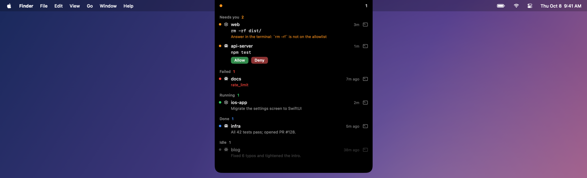
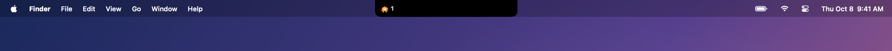
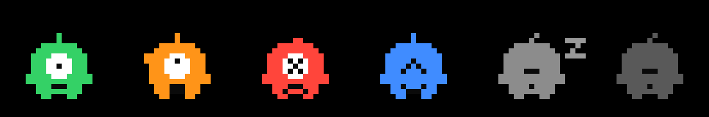
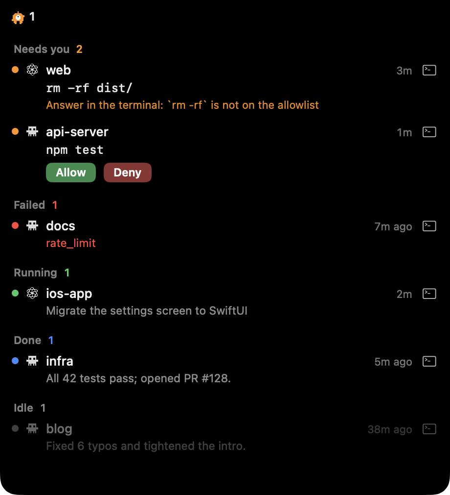

# Perch

**Your AI coding agents, live in the MacBook notch.** See at a glance which session is running, which one needs you, and which one finished or failed. Approve safe commands right there, or click to jump back to the right terminal.

<p align="center"></p>

The loop it is built for: **an agent is waiting for you → the notch lights up → you handle it in place, or jump back.**

- **One row per agent session**, in five states: 🟠 Needs you · 🔴 Failed · 🟢 Running · 🔵 Done · ⚪ Idle.
- **A pixel cyclops lives in the notch** and acts out the most urgent state: it trots while an agent runs, waves at you when one needs you, and hops when one starts needing you, fails or finishes.
- **Allow / Deny in the notch** for commands on your allowlist (`npm test`, `git status`, …). Everything else shows the full command and *Answer in the terminal*.
- **Click a row** to go back to its terminal (the exact Ghostty tab) or its desktop app.
- **A Todo tab** for your own todos, grouped High / Normal / Low. They live in a Reminders list called "Perch", so they're on your iPhone too. Add one from anywhere with ⌥⇧Space without leaving your terminal.
- Works with **Claude Code** and **Codex** (in the terminal or their desktop apps) and **Grok** (the `grok` CLI), through their hooks. No changes to how you run them.

macOS 14+. Prebuilt for Apple silicon; builds from source on any Mac, Intel included. On displays without a notch it sits in a small capsule at the top of the screen.

**Installing with an AI agent?** Tell it: *"Install Perch on this Mac by following https://github.com/cryptowizard0/perch#install-with-an-ai-agent"*.

## Install

Apple silicon, macOS 14+. Install the app, open it once past Gatekeeper, and click **Connect** in the notch. On an Intel Mac, install [from source](#from-source).

**Homebrew**, from Perch's own tap (this repository):

```bash
brew tap cryptowizard0/perch https://github.com/cryptowizard0/perch
brew install --cask cryptowizard0/perch/perch
```

Use the full name `cryptowizard0/perch/perch`: Homebrew loads casks from a non-official tap only once you trust them, and installing by full name trusts this one.

**Or download** `perch-<version>-macos-arm64.zip` from the [latest release](https://github.com/cryptowizard0/perch/releases/latest), unzip it, and drag `Perch.app` into Applications. It has to be in `/Applications` or `~/Applications`: opened from Downloads, Perch shows no setup.

### 1. Open it past Gatekeeper (once)

Perch is ad-hoc signed, not notarized, so macOS blocks the first open ("Apple could not verify “Perch”…"). Click **Done**, then open **System Settings → Privacy & Security**, scroll to **Security** and click **Open Anyway** next to Perch (the button stays for about an hour after the blocked open), and enter your password. From then on Perch opens normally.

### 2. Connect your agents

On the first open the notch opens by itself with a setup card listing the agents it found: Claude Code if `~/.claude` exists, Codex if `~/.codex` does, Grok if `~/.grok` does (`$CLAUDE_CONFIG_DIR` / `$CODEX_HOME` / `$GROK_HOME` are honoured). Click **Connect**: Perch adds its hooks to their settings, only its own, after backing the file up as `.perch-backup`. **Open at login** is checked by default. Nothing in an agent's config changes before you click Connect.

Behind the scenes the app copies `perch` and `perchd` into `~/.perch/bin`, the fixed location every hook runs, and installs `perchd` as a launchd agent. Your choices are kept in `~/.perch/agents.json`. An agent you install later shows up as *Codex found · Connect*; right-click the notch → **Agents** to connect or disconnect one.

### 3. Codex: trust the hooks (once)

**Codex skips new hooks silently until you trust them**, so until you do, Codex sessions never show up and the notch shows *Trust Perch's hooks: run /hooks in codex*. Start `codex`, type `/hooks`, trust Perch's six hooks (UserPromptSubmit, PermissionRequest, PostToolUse, Stop, Interrupt, SessionEnd), then open a new Codex session; the row goes away on its first event.

Codex remembers trust per hook content, so it asks again only when an upgrade changes Perch's hooks. Claude Code needs no such step.

### Grok

Perch keeps Grok's hooks in a file of its own, `~/.grok/hooks/perch.json`, and Grok runs it without asking. Grok reads hooks when a session starts, so restart running `grok` sessions after connecting (or press `r` in `/hooks`).

**The notch can't approve Grok's commands.** Grok has no hook that can answer its permission prompt, so a Grok session that needs you says *Answer in the terminal*. Grok doesn't say which command it's asking about either, so the row shows *Tool permission requested* instead of the command.

### `perch` in the terminal

Homebrew puts `perch` on your `PATH`. Otherwise link it: `ln -s ~/.perch/bin/perch ~/.local/bin/perch` (any directory on your `PATH`). Open the app once first: `~/.perch/bin` appears then, and until macOS has let Perch open, nothing inside the app runs.

### Upgrade

Replace the app: `brew upgrade --cask cryptowizard0/perch/perch`, or drag the new `Perch.app` over the old one. On launch it copies its `perch` / `perchd` into `~/.perch/bin`, restarts `perchd` and updates Perch's hooks. A v0.3 install (binaries and hooks in `~/.local/bin`) is migrated the same way; Codex asks for trust once more.

### Uninstall

Right-click the notch → **Uninstall Perch…**. It removes Perch's hooks from every agent, stops `perchd` and removes its launchd agent and `~/.perch/bin`, turns off Open at login and moves the app to the Trash. `~/.perch` keeps the database, `allowlist.json` and `agents.json`, so a reinstall picks up where you left off.

With Homebrew, use `brew uninstall --cask cryptowizard0/perch/perch` instead (the same removal); `brew uninstall --cask --zap cryptowizard0/perch/perch` also deletes `~/.perch`. From a terminal: `perch uninstall` (`--purge` also deletes `~/.perch`), then delete the app.

### From source

Needs a Swift 5.9+ toolchain: Xcode or just the Command Line Tools (`xcode-select --install`).

```bash
git clone https://github.com/cryptowizard0/perch.git && cd perch
scripts/install.sh
```

It builds `Perch.app` into `~/Applications` (`APPDIR=/Applications` also works) and opens it: the same first run as above, without the Gatekeeper step. It links `perch` / `perchd` into `~/.local/bin` (`PREFIX=…`). Re-run it after pulling to upgrade: a development build keeps its version number, so the script also runs the bundled `perch setup --upgrade`, which copies the new binaries, restarts `perchd` and repairs the hooks of connected agents, and connects nothing new.

This is the only way onto an Intel Mac: the release zip and the Homebrew cask are Apple silicon only. A source build runs natively on whichever Mac built it.

## Install with an AI agent

Steps for a coding agent (Claude Code, Codex, Grok, …) installing Perch for its user. Every step is a shell command with a checkable result. The few things only a person can do are marked **👤 Ask the user**: stop there and wait.

### 0. Look at the Mac

```bash
sw_vers -productVersion                                    # 14.0 or later, or stop: Perch needs macOS 14
uname -m                                                   # arm64 = Apple silicon, x86_64 = Intel
ls -d ~/.claude ~/.codex ~/.grok 2>/dev/null               # the agents Perch can connect
ls -d /Applications/Perch.app ~/Applications/Perch.app 2>/dev/null   # already installed? go to "Upgrade"
```

### 1. Pick a path

| `uname -m` | Path | 👤 steps |
| --- | --- | --- |
| `arm64` | **A. Homebrew** (the release build), if `brew` is installed and the user prefers it | Open Anyway once, then Connect |
| `arm64` or `x86_64` | **B. From source** | none, if the Command Line Tools are installed |

On `x86_64` only path B works: the cask refuses Intel (`depends_on arch: :arm64`) and the release zip is `arm64` only. Intel Macs have no notch, so tell the user to look for Perch's capsule at the top centre of the screen.

### 2A. Homebrew (Apple silicon)

```bash
brew tap cryptowizard0/perch https://github.com/cryptowizard0/perch
brew install --cask cryptowizard0/perch/perch    # the full name: Homebrew refuses the short one from an untrusted tap
```

**👤 Ask the user** to do both of these, then wait:

1. Open Perch from Applications. macOS says *"Apple could not verify “Perch”…"*: click **Done**, open **System Settings → Privacy & Security**, click **Open Anyway** next to Perch, and enter the password.
2. Perch opens. In the card that drops out of the notch (or the capsule at the top of a screen without one), click **Connect**.

Until step 1 is done, macOS kills every program inside Perch.app (exit 137), so don't run anything from the app before then. Don't remove the quarantine attribute yourself: approving an unnotarized app is the user's decision. Then go to step 3.

### 2B. From source (Apple silicon or Intel)

```bash
xcode-select -p    # prints a path when a Swift toolchain is installed
```

If it fails, **👤 ask the user** to run `xcode-select --install` and finish the dialog it opens. The full Xcode isn't needed.

```bash
git clone https://github.com/cryptowizard0/perch.git && cd perch
APP=~/Applications/Perch.app scripts/bundle-app.sh     # builds and assembles the app, takes a few minutes, doesn't open it
~/Applications/Perch.app/Contents/Helpers/perch setup --json
open ~/Applications/Perch.app
```

Keep this order: `perch setup` before the first `open`. Setup copies `perch` / `perchd` into `~/.perch/bin`, installs `perchd` as a launchd agent, and connects every agent found (name some to connect only those: `perch setup claude-code codex`). The app then sees the choice already made and shows no setup card. `APP=/Applications/Perch.app` also works. Anywhere else, the app maintains nothing.

This path doesn't turn on **Open at login**. Tell the user: right-click the notch → **Open at Login**.

### 3. Check

```bash
~/.perch/bin/perch --version                                        # prints the version
launchctl print gui/$(id -u)/dev.perch.perchd | grep -m1 'state ='  # state = running
~/.perch/bin/perch session ls --json                                # {"ok":true,"sessions":[…]}
cat ~/.perch/agents.json                                            # "status" : "on" for each connected agent
pgrep -x Perch                                                      # the app is running
```

`perch setup --json` (path B) printed each agent's `state`: `connected`; `needsTrust` (Codex, see below); `notDetected` (not on this Mac); or with `"ok": false`, an `error` to report to the user. Path B can re-run it any time.

### 4. Hand back to the user

Tell them what's left, since only they can do it:

- **Codex** (`needsTrust`, or path A connected Codex): Codex ignores new hooks until trusted. Start `codex`, type `/hooks`, trust Perch's six hooks, then open a new Codex session.
- **Grok**: restart running `grok` sessions; hooks load when a session starts.
- **Claude Code**: nothing to do. Running sessions pick the hooks up on their own.
- Hover the notch to see the panel. The next prompt in any connected agent shows up as a row.

### Upgrade, uninstall

- Path A: `brew upgrade --cask cryptowizard0/perch/perch`. Path B: `git pull && scripts/install.sh` in the checkout (add `APPDIR=/Applications` if the app lives there). It quits the app, rebuilds it, repairs the hooks, connects nothing new, and reopens the app.
- Uninstall: `~/.perch/bin/perch uninstall --json` (keeps the data in `~/.perch`; `--purge` deletes it), then delete `Perch.app`. Homebrew installs: `brew uninstall --cask cryptowizard0/perch/perch`.

### Don't

- Don't edit Perch's hooks into `~/.claude/settings.json`, `~/.codex/hooks.json` or `~/.grok/hooks/perch.json` by hand. Use `perch setup` / `perch hooks install <agent>`, which back the file up and touch only Perch's own entries.
- Don't set `PERCH_HOME`. It's for development, and an app running with it installs nothing.
- Don't connect Hermes: it isn't supported in the panel right now.

## Use

| | |
| --- | --- |
| Hover the notch | Expand the panel |
| Click a row | Jump to that session's terminal or app; a Done session turns Idle |
| **Allow** / **Deny**, or ⌥⇧A / ⌥⇧D | Answer the first request in the panel |
| ⌥⇧O | Jump to the session that has waited longest |
| Right-click a row | *Remove from Panel* (its next event brings it back) |

The shortcuts exist only while there is something to answer or jump to, so the rest of the time those keys type as usual.

```bash
perch session ls                       # what the panel shows, in the terminal
perch allowlist                        # what may be approved from the notch
perch allowlist check Bash "npm test"  # would this be?
perch allowlist init                   # write ~/.perch/allowlist.json to edit
```

### Todo

The expanded notch has two tabs, picked from the icons left of the notch: **Agents** (the mascot; an orange dot while a session needs you, red while one failed) and **Todo** (a checklist with your open count). The panel opens on Agents whenever a session needs you or failed; otherwise on the tab you last picked. The folded notch shows your open count on its right wing, next to a checklist icon (dimmed when there's nothing open); todos never pulse, chime, or move the mascot.

The Todo tab shows the **"Perch" list in Apple Reminders**, grouped High / Normal / Low, oldest first. Due dates show on the right of each row (Today, Tomorrow, a weekday, or a date), white once overdue. Add a todo on your iPhone and it shows up in the notch; complete or add one in the notch and it's in Reminders, and on your phone through iCloud. The first time you open the tab, click **Connect Reminders** and allow access; Perch finds the "Perch" list or creates it in iCloud. If you delete the list, the tab offers **Create Perch list**; Perch never recreates it on its own. High and Low match Reminders' High and Low; Normal is "no priority" (Medium on the phone also shows as Normal).

| | |
| --- | --- |
| ⌥⇧Space, anywhere | Add a todo in a small popup under the notch; your terminal stays in front |
| *+ Add a todo* | The same popup, under the panel |
| In the popup | Type the title (stored exactly as typed). Tab / Shift-Tab picks High / Normal / Low. Return adds and stays open for the next one. Esc closes. |
| Click a todo's circle or title | Completed in Reminders after 3 seconds; *Undo* (or another click) takes it back |
| ✎ on a row | Open that reminder in the Reminders app, for everything Perch doesn't edit (subtasks, flags, …) |
| Right-click → *Edit…* | A larger editor: title, notes, date and time, priority, URL. Return saves, Esc cancels. A time you set notifies just like one set in Reminders |
| Right-click → *Priority* / *Delete* | Re-rank it, or delete it at once (it goes to Reminders' Recently Deleted) |

The CLI and `~/.perch/inbox.md` change the same list, through Perch.app: it applies the change in Reminders before `perch` returns, so `perch ls` right after always shows it. If Perch.app isn't running (or doesn't answer within 2 seconds), the command fails with one line and nothing is saved for later. Lines you append to `inbox.md` (`- [ ] title`) wait in the file until Perch.app is running, then become reminders.

```bash
perch add "Renew passport" -p high --due 2026-11-03     # a day; --due @15:00 or +2h for a time
perch add "Read the RFC" --link https://example.com/rfc --key rfc  # same --key again updates it instead of adding another
perch ls                               # open todos by priority, High and Low marked, each with a short id
perch ls --status done                 # completed in the last 7 days
perch done t7k2                        # also: perch update t7k2 --status open (reopen), perch rm t7k2
defaults write dev.perch.app QuickEntryHotKey "ctrl+opt+n"   # another shortcut (relaunch Perch)
```

While Perch.app isn't connected, `perch ls` still lists the todos it saw last and says how old they are on stderr ("Todos as of 14:02 — Perch.app isn't connected"); `--json` adds `todos_as_of`, and `todo.md` an "As of" line.

## Safety

- **Perch never allows anything by default.** If you don't answer in the notch within 20 seconds, the agent's own prompt appears in the terminal as usual.
- Only commands on the allowlist get buttons. The default is strict: read-only tools (Read, Glob, Grep, WebFetch, WebSearch) and a few Bash commands (`npm test`, `pytest`, `cargo test`, `git status` / `diff` / `log`). Any shell operator (`;`, `|`, `>`, `$(…)`, …), `rm`, `sudo`, and writes to `.env`, `~/.ssh` or `*.pem` always go to the terminal. A broken allowlist file approves nothing.
- The panel always shows the full command, never a summary.

## Troubleshooting

| Symptom | Check |
| --- | --- |
| "Apple could not verify “Perch”…" | Expected once: **Open Anyway** in System Settings → Privacy & Security (see [Install](#1-open-it-past-gatekeeper-once)). |
| No setup card, no setup rows, no Agents menu | The app must run from `/Applications` or `~/Applications` (macOS runs apps opened from Downloads from a hidden copy), with `PERCH_HOME` unset. The card itself appears only on the first run; afterwards use the *found · Connect* rows or right-click → **Agents**. |
| Codex sessions never appear | The hooks are not trusted yet: `/hooks` in `codex` (see [Codex](#3-codex-trust-the-hooks-once)). `grep -A1 'hooks.json:permission_request' ~/.codex/config.toml` shows a `trusted_hash` once they are. |
| Grok sessions never appear | Restart the `grok` session (hooks load when it starts), then check `/hooks` in `grok`: Perch's eight hooks should be listed under Global. A work machine may allow only managed hooks (`allow_managed_hooks_only`; `grok inspect` names the file that sets it). |
| Claude Code sessions never appear | Claude Code needs no trust step and picks up new hooks on its own. Type `/hooks` in `claude`: Perch's eight hooks should be listed under user settings. If not, check for `"disableAllHooks": true` in any settings file (a project's settings override yours), `allowManagedHooksOnly` in managed settings on a work machine, and that Perch connected the settings file Claude Code reads (the card shows the path; `CLAUDE_CONFIG_DIR` must match). |
| No session appears for any agent | An error row in the notch says what failed. `perch session ls` must list sessions; if it cannot connect, `perchd` is not running: quit Perch and open it again (it reinstalls the launchd agent if it is gone), or run `perch setup`. |
| `perch: open Perch.app once to finish installing` | Homebrew's `perch` runs `~/.perch/bin/perch`, which the app installs on its first open. |
| The notch doesn't come back after a restart | Right-click the notch → **Open at Login**; if it says *allow in System Settings*, turn Perch on under System Settings → General → Login Items. |
| A hook fails | Hooks never print anything or block the agent; failures go to `~/.perch/hook.log`. No such file usually means the hook was never run at all. |

## How it works

```
Claude Code / Codex / Grok ──hook──▶ perch hook ──▶ perchd ──events──▶ Perch.app (notch)
                                                    SQLite, ~/.perch/perchd.sock
```

- `perch` is the CLI and the hook adapter. It reports each hook event (prompt, needs you, done, failed, …) as a session update.
- `perchd` is the daemon and the only thing that touches the database. It runs the session state machine and pushes changes to the app, never polled: CLI to notch averages about 15 ms (budget 200 ms).
- `Perch.app` is the notch panel (AppKit + SwiftUI).

`perch watch --json` streams the same events, one JSON object per line. Every command takes `--json`; `perch --help` lists them all, including the todo commands (`add` / `ls` / `done` / `update` / `rm`) behind the Todo tab.

## Develop

No Xcode project: everything is SwiftPM.

```bash
swift build && swift test                              # CLI, daemon, libraries, tests
scripts/bundle-app.sh && open .build/Perch.app          # the notch app (CONFIG=debug for a debug build)
PERCH_HOME=/tmp/perch-dev swift run perchd --no-http    # a daemon with its own data, away from ~/.perch
scripts/measure-latency.sh                              # CLI → notch latency
```

Design notes (in Chinese): [docs/PRD.md](docs/PRD.md) (product), [docs/MILESTONES.md](docs/MILESTONES.md), [project.md](project.md) (status and handover), [CLAUDE.md](CLAUDE.md) (architecture rules).

## Screenshots

Collapsed, the notch shows the mascot acting out the most urgent session's state, and how many sessions are running:

<p align="center"></p>

<p align="center"></p>

Running trots and looks around, Needs you waves and flashes its antenna, Failed and Done stand still, Idle sleeps. It moves only when it has something to say, and stays still with Reduce Motion on.

Expanded on hover, sessions are grouped by state, most urgent first:

<p align="center"></p>

Each row shows the agent (Claude Code's pixel monster, Codex's knot, Grok's slashed ring), the project, how long it has been in that state, and a second line: the prompt while running, the full command when it needs you, the error when it failed, the last reply when done.

## License

[MIT](LICENSE)
