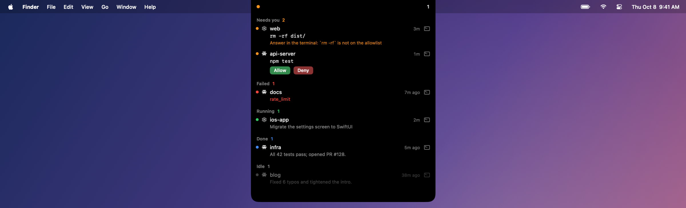
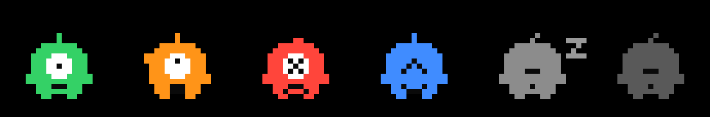
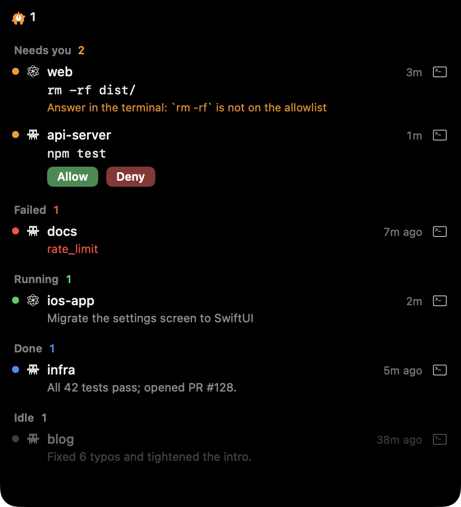

# Perch

**All your AI coding agents, aggregated live in the MacBook notch.** Pulls together real-time session status across Claude Code, Codex, Grok, Cursor, Antigravity, and DeepSeek (`dsh`) in one place — see which agent is running, waiting on you, done, or failed, approve safe commands right in the notch, or click to jump back to the exact terminal.

<p align="center"></p>

> **macOS 14+** · Prebuilt for Apple silicon (Intel builds from source) · Displays without a notch get a compact top-bar capsule.

- **Five session states** in one view: 🟠 Needs you · 🔴 Failed · 🟢 Running · 🔵 Done · ⚪ Idle.
- **Notch mascot**: A pixel cyclops reflects the most urgent state — trots while running, waves when waiting, hops on alerts, and follows your pointer (still when Reduce Motion is on).
- **In-notch Allow / Deny**: Approve allowlisted commands (`npm test`, `git status`, …) without switching windows; everything else shows the full command and points you to the terminal.
- **One-click jump**: Click any row to focus its exact Ghostty tab, terminal, or desktop app.
- **Apple Reminders Todo tab**: Syncs with your "Perch" list (plus any other Reminders lists you pick), with local *Doing* markers (`▶`) and global quick-add (`⌥⇧Space`).

<p align="center">
  <br>
  <br>
  
</p>

## Supported Agents

Perch connects through each agent's native hooks or plugin — no changes to how you run them.

| Agent | Notch Approval | Notes |
| --- | --- | --- |
| **Claude Code** (CLI & desktop app) | Allowlist | Hot-reloads hooks automatically; ignores Cursor's third-party hook duplicates |
| **Codex** (CLI & desktop app) | Allowlist | Run `/hooks` in `codex` once to trust Perch's 6 hooks |
| **Grok** (`grok` CLI) | Terminal only | Restart running sessions after connecting; Grok doesn't expose command text or hook approval |
| **Cursor** (Agent panel & `cursor-agent`) | Status only | Auto-reloads `~/.cursor/hooks.json`; no approval hook (never shows *Needs you*) |
| **Antigravity** (App, IDE & `agy`) | Status only | Uses named `"perch"` hook in `~/.gemini/config/hooks.json`; no approval hook (never shows *Needs you*) |
| **DeepSeek (`dsh`)** (`dsh tui` & `dsh web`) | Terminal / web only | Mounted via `perch-dsh.mjs` in `~/.dsh/cordis.patch.yml`; restart running sessions (`dsh headless` hidden; web rows expire after 30m idle) |

## Install

> **Installing with an AI agent?** Tell it: *"Install Perch on this Mac by following https://github.com/cryptowizard0/perch#install-with-an-ai-agent"*.

### Homebrew (Apple silicon)

```bash
brew tap cryptowizard0/perch https://github.com/cryptowizard0/perch
brew install --cask cryptowizard0/perch/perch
```

Use the full cask name (`cryptowizard0/perch/perch`) so Homebrew trusts this tap.

### Direct Download (Apple silicon)

Download `perch-<version>-macos-arm64.zip` from the [latest release](https://github.com/cryptowizard0/perch/releases/latest), unzip, and move `Perch.app` into `/Applications` or `~/Applications` (running from Downloads disables setup).

To put `perch` on your `PATH` without Homebrew, open the app once and run `ln -s ~/.perch/bin/perch ~/.local/bin/perch`.

### From Source (Apple silicon & Intel)

Requires Swift 5.9+ (Xcode or `xcode-select --install`):

```bash
git clone https://github.com/cryptowizard0/perch.git && cd perch
scripts/install.sh   # builds into ~/Applications (APPDIR=/Applications also works) and opens it
```

### First-Run Setup

1. **Allow past Gatekeeper once** *(Homebrew / zip)*: Perch is ad-hoc signed, not notarized. Click **Done** on the warning, then **System Settings → Privacy & Security → Open Anyway** next to Perch.
2. **Connect your agents**: On first launch, the notch opens a setup card for detected agents (`~/.claude`, `~/.codex`, `~/.grok`, `~/.cursor`, `~/.gemini`, `~/.dsh`; respects `$CLAUDE_CONFIG_DIR`, `$CODEX_HOME`, `$GROK_HOME`, `$DSH_HOME`). Click **Connect** — Perch backs up each config to `.perch-backup`, installs `perch`/`perchd` into `~/.perch/bin`, and registers `perchd` with launchd. Manage agents later via right-click → **Agents**.
3. **Codex users**: Start `codex`, run `/hooks`, trust Perch's 6 hooks, and open a new session (needed once, or after an upgrade updates the hooks).

### Upgrade & Uninstall

- **Upgrade**: `brew upgrade --cask cryptowizard0/perch/perch`, drag a new `Perch.app` over the old one, or re-run `scripts/install.sh` from a source checkout. Launching updates binaries, restarts `perchd`, and repairs hooks automatically.
- **Uninstall**: Right-click the notch → **Uninstall Perch…** (or `brew uninstall --cask cryptowizard0/perch/perch`, or `perch uninstall` + delete the app). Your data in `~/.perch` is kept unless you pass `--zap` (Homebrew) or `--purge` (CLI).

## Usage

### Controls & Shortcuts

Global shortcuts are only bound while relevant, so keys work normally the rest of the time.

| Action | Effect |
| --- | --- |
| Hover the notch | Expand the panel |
| Click a session row | Jump to its terminal/app (marks *Done* as *Idle*) |
| **Allow** / **Deny** (`⌥⇧A` / `⌥⇧D`) | Answer the first waiting permission request |
| `⌥⇧O` | Jump to the session waiting longest |
| `⌥⇧Space` | Quick-add a todo from anywhere (without leaving your terminal) |
| Right-click row / notch | Remove session from panel · manage **Agents**, **Lists…**, **Open at Login**, or **Uninstall** |

### Todo Tab

Switch between **Agents** and **Todo** using the icons left of the notch (the panel automatically opens on Agents whenever a session needs you or fails).

- **Apple Reminders sync**: Shows your `"Perch"` list plus any other lists you check under right-click → **Lists…** (drag to reorder). Changes sync with iPhone via iCloud.
- **Row actions**: Click a circle/title to complete (3s *Undo*), hover and click `▶` to mark **Doing** (local to Perch, pinned to top of its list), click `✎` to open in Reminders, or right-click to edit, reprioritize, or delete.
- **Offline inbox**: Append `- [ ] title` lines to `~/.perch/inbox.md` anytime; Perch imports them into Reminders once running.

### CLI

Every command supports `--json`; run `perch --help` for the full list.

```bash
# Sessions & allowlist
perch session ls                                # current panel state
perch watch --json                              # stream live session events (NDJSON)
perch allowlist                                 # view notch-approvable rules
perch allowlist check Bash "npm test"           # test a command against the allowlist
perch allowlist init                            # create ~/.perch/allowlist.json to customize

# Todos (syncs through running Perch.app)
perch add "Renew passport" -p high --due 2026-11-03
perch add "Read RFC" --link https://example.com/rfc --key rfc --list Errands
perch ls                                        # open todos by list (--status done for recent)
perch update t7k2 --doing                       # mark Doing (--no-doing to clear, --list to move)
perch done t7k2                                 # complete (or `perch rm t7k2` to delete)
```

Change the quick-entry hotkey with `defaults write dev.perch.app QuickEntryHotKey "ctrl+opt+n"` and relaunch Perch.

## Safety

- **Never allows by default**: If you don't respond in the notch within 20 seconds, the agent's normal terminal prompt takes over.
- **Strict default allowlist**: Only read-only tools (`Read`, `Glob`, `Grep`, `WebFetch`, `WebSearch`) and safe commands (`npm test`, `pytest`, `cargo test`, `git status` / `diff` / `log`) get notch buttons. Shell operators (`;`, `|`, `>`, `$(…)`), `rm`, `sudo`, and edits to `.env`, `~/.ssh`, or `*.pem` always go to the terminal. A malformed allowlist approves nothing.
- **Full command visibility**: The panel always displays the exact command, never a summary.

## Architecture & Development

```text
Claude Code / Codex / Grok / Cursor / Antigravity / dsh
    ──hook──▶ perch ──▶ perchd (SQLite, ~/.perch/perchd.sock) ──events──▶ Perch.app
```

- **`perch`**: CLI and hook adapter that turns agent hook events into session updates.
- **`perchd`**: Background daemon owning SQLite state and pushing updates to the app (~15 ms CLI-to-notch latency, no polling).
- **`Perch.app`**: Native macOS notch panel built with AppKit + SwiftUI.

Everything builds with SwiftPM (no Xcode project):

```bash
swift build && swift test                               # build & test CLI, daemon, libraries
scripts/bundle-app.sh && open .build/Perch.app          # build & run app (CONFIG=debug for debug)
PERCH_HOME=/tmp/perch-dev swift run perchd --no-http    # isolated dev daemon away from ~/.perch
scripts/measure-latency.sh                              # benchmark CLI → notch latency
```

Design docs (Chinese): [PRD](docs/PRD.md) · [Milestones](docs/MILESTONES.md) · [Project status](project.md) · [Architecture rules](CLAUDE.md)

## Troubleshooting

<details>
<summary>Common issues and diagnostics</summary>

| Symptom | Fix / Check |
| --- | --- |
| *"Apple could not verify “Perch”"* | Expected once on Homebrew/zip installs: **System Settings → Privacy & Security → Open Anyway**. |
| No setup card or **Agents** menu | Run `Perch.app` from `/Applications` or `~/Applications` with `PERCH_HOME` unset. |
| **Codex** sessions missing | Trust hooks via `/hooks` in `codex`. Verify with `grep -A1 'hooks.json:permission_request' ~/.codex/config.toml` (`trusted_hash`). |
| **Claude Code** sessions missing | Check `/hooks` in `claude` (8 Perch hooks). Check for `"disableAllHooks": true`, `allowManagedHooksOnly`, or mismatched `CLAUDE_CONFIG_DIR`. |
| **Grok** sessions missing | Restart running `grok` sessions and check `/hooks` (8 global hooks) and `allow_managed_hooks_only` via `grok inspect`. |
| **Cursor** sessions missing | Check Cursor's Hooks output channel (4 hooks); repair with `perch setup cursor`. Cloud/background agents don't run user hooks. |
| **Antigravity** sessions missing | Verify the `"perch"` hook in `~/.gemini/config/hooks.json`; repair with `perch setup antigravity`. |
| **dsh** sessions missing | Restart dsh. Verify `dsh <profile> --dump-config \| grep -A3 'id: perch'` and `~/.perch/bin/perch-dsh.mjs`; repair with `perch setup dsh`. |
| No sessions from any agent | Run `perch session ls`. If `perchd` isn't running, restart `Perch.app` or run `perch setup`. |
| `perch: open Perch.app once to finish installing` | Launch `Perch.app` once so it copies binaries into `~/.perch/bin`. |
| App doesn't start on login | Right-click notch → **Open at Login**, and check **System Settings → General → Login Items**. |
| Hook failures | Hooks never block agents; inspect `~/.perch/hook.log` (missing file usually means the hook never fired). |

</details>

## Install with an AI agent

<details>
<summary>Step-by-step playbook for coding agents (Claude Code, Codex, Grok, dsh, …)</summary>

Steps marked **👤 Ask the user** require human action — pause there and wait.

### 1. Inspect the Mac

```bash
sw_vers -productVersion                                                  # must be >= 14.0
uname -m                                                                 # arm64 (Apple silicon) or x86_64 (Intel)
ls -d ~/.claude ~/.codex ~/.grok ~/.cursor ~/.gemini ~/.dsh 2>/dev/null  # detected agents
ls -d /Applications/Perch.app ~/Applications/Perch.app 2>/dev/null       # already installed? jump to Upgrade
```

- **`arm64` + `brew` available** (preferred): follow **Path A (Homebrew)**.
- **`x86_64`** (or user prefers source): follow **Path B (From source)** — the cask and release zip are `arm64`-only. Note Intel Macs have no notch (capsule appears at top center).

### 2A. Path A — Homebrew (Apple silicon)

```bash
brew tap cryptowizard0/perch https://github.com/cryptowizard0/perch
brew install --cask cryptowizard0/perch/perch   # full name required for untrusted tap
```

**👤 Ask the user** to do both steps, then wait:
1. Open Perch from Applications → click **Done** on the Gatekeeper dialog → **System Settings → Privacy & Security → Open Anyway** (enter password).
2. Click **Connect** in the setup card that drops from the notch/capsule.

*(Do not run binaries inside `Perch.app` before step 1 — macOS kills them with exit 137. Do not remove quarantine attributes yourself.)*

### 2B. Path B — From source (Apple silicon or Intel)

```bash
xcode-select -p   # if this fails, 👤 ask the user to run `xcode-select --install` and finish the dialog
git clone https://github.com/cryptowizard0/perch.git && cd perch
APP=~/Applications/Perch.app scripts/bundle-app.sh   # APP=/Applications/Perch.app also works
~/Applications/Perch.app/Contents/Helpers/perch setup --json
open ~/Applications/Perch.app
```

Keep that order (`perch setup` before first `open`). Pass specific agent names to limit setup (e.g. `perch setup claude-code codex`). Remind the user to enable **Open at Login** via right-click on the notch.

### 3. Verify

```bash
~/.perch/bin/perch --version
launchctl print gui/$(id -u)/dev.perch.perchd | grep -m1 'state ='   # expect: state = running
~/.perch/bin/perch session ls --json                                 # expect: {"ok":true,"sessions":[…]}
cat ~/.perch/agents.json                                             # expect: "status": "on" for connected agents
pgrep -x Perch
```

### 4. Hand Back to the User

Tell the user any remaining per-agent steps:
- **Codex** (`needsTrust` or Path A): run `/hooks` in `codex`, trust Perch's 6 hooks, start a new session.
- **Grok / dsh**: restart running sessions so hooks/plugins load.
- **Claude Code / Cursor / Antigravity**: ready immediately (note Cursor and Antigravity never show *Needs you*).

### Upgrade, Uninstall & Guardrails

- **Upgrade**: Path A: `brew upgrade --cask cryptowizard0/perch/perch`. Path B: `git pull && scripts/install.sh` (pass `APPDIR=/Applications` if installed there).
- **Uninstall**: `~/.perch/bin/perch uninstall --json` (`--purge` deletes `~/.perch`) then remove `Perch.app`; or `brew uninstall --cask cryptowizard0/perch/perch`.
- **Don't** hand-edit agent config files (`settings.json`, `hooks.json`, `cordis.patch.yml`); always use `perch setup` / `perch hooks install <agent>`.
- **Don't** set `PERCH_HOME` (dev-only; disables installation) or connect unsupported `hermes`.

</details>

## License

[MIT](LICENSE)
